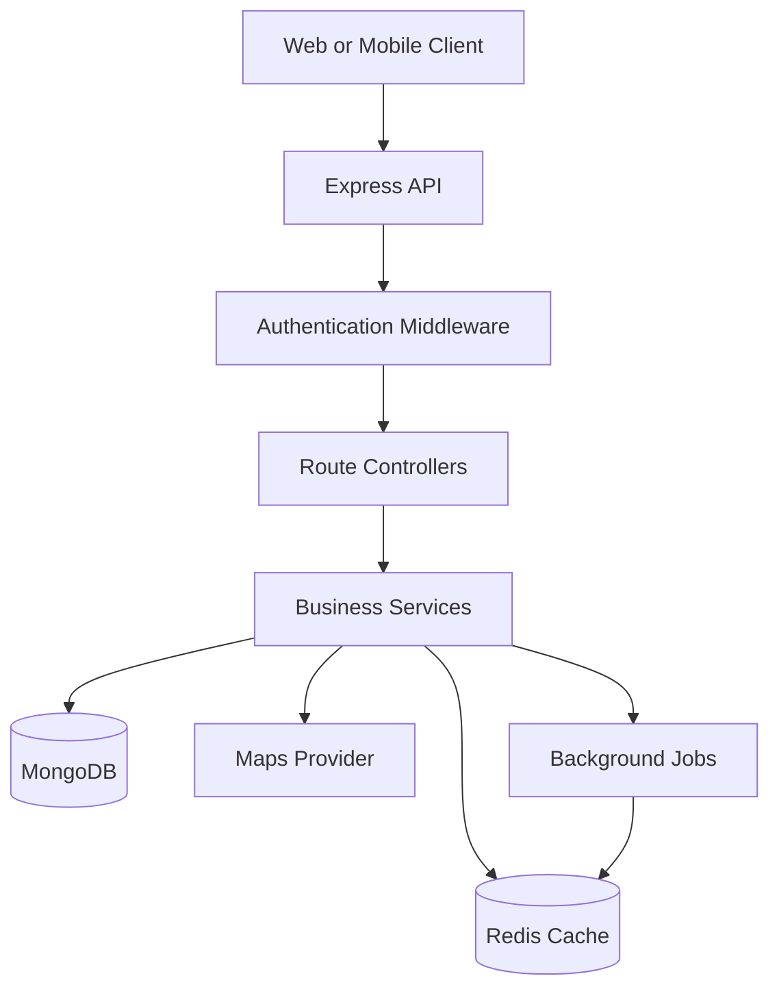
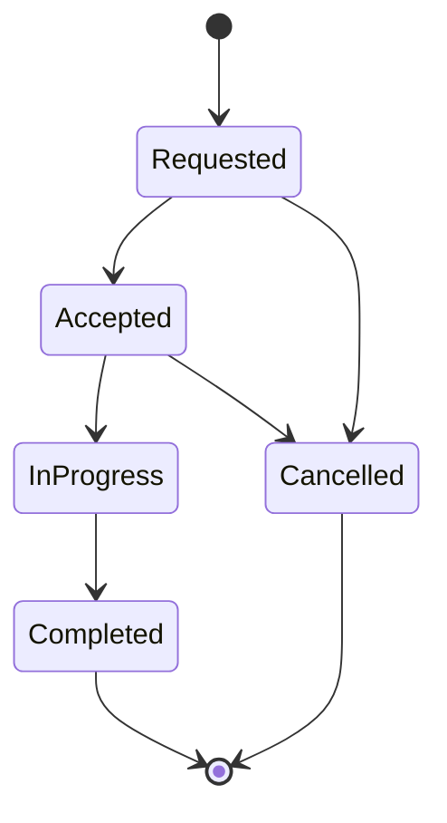

# 🚗 RideFlow — Scalable Ride-Hailing Backend

<p align="center">
  A modern ride-booking backend engineered for secure authentication, intelligent fare estimation, efficient caching, and scalable ride management.
</p>

<p align="center">
  
  
  
  
  
  
</p>

---

## 📌 Overview

RideFlow is a ride-hailing backend inspired by real-world mobility platforms. It connects passengers with captains, calculates estimated fares, retrieves route information, and manages ride requests through RESTful APIs.

The project focuses on more than CRUD operations. It explores backend engineering concepts such as authentication, caching, database indexing, API security, concurrency, and scalable service architecture.

**Primary objective:** Build a backend that is secure, maintainable, observable, and designed to evolve from a monolithic application into a distributed system.

## ✨ Key Features

### 👤 Authentication & Identity
- User registration and login.
- Captain registration with vehicle information.
- JWT-based authentication.
- Protected profile endpoints.
- Logout and token invalidation.
- Input validation and centralized error handling.

### 🚕 Ride Management
- Create ride requests with pickup and destination.
- Support for cars, motorcycles, and auto-rickshaws.
- Calculate estimated fares for supported vehicle types.
- Track ride status and journey information.
- Generate an OTP for ride verification.

### 🗺️ Location & Routing
- Convert addresses into geographical coordinates.
- Calculate route distance and estimated travel time.
- Provide address autocomplete suggestions.
- Integrate with a maps provider through a dedicated service layer.

### ⚡ Performance & Scalability
- Redis caching for frequently accessed data.
- Cache expiration using TTL.
- Rate limiting for sensitive endpoints.
- Database indexes for common queries.
- Pagination for growing datasets.
- Background jobs for asynchronous operations.

> Redis caching, rate limiting, background jobs, and the advanced security features below are architectural targets unless they have already been implemented and tested in the codebase.

## 🛠️ Tech Stack

| Technology | Purpose |
|---|---|
| Node.js | JavaScript runtime |
| Express.js | REST API and middleware |
| MongoDB | Persistent application data |
| Mongoose | Schema modeling and validation |
| Redis | Caching, token revocation, and ephemeral state |
| JWT | Stateless authentication |
| bcrypt | Password hashing |
| Maps API | Geocoding, routes, and suggestions |
| Docker | Containerization |
| GitHub Actions | CI/CD automation |
| Jest / Supertest | Automated testing |

## 🏗️ System Architecture



### Architecture principles

- **Separation of concerns:** Routes, controllers, services, models, and middleware have distinct responsibilities.
- **Caching:** Frequently requested, relatively stable data can be served from Redis.
- **Persistence:** MongoDB remains the source of truth for durable application data.
- **External integrations:** Maps-provider logic is isolated from ride-management logic.
- **Stateless API design:** JWTs support authentication across application instances, while revocation and session policies require additional server-side handling.

## ⚡ Redis: Caching & Distributed State

Redis can reduce repeated database reads and improve response times for suitable workloads.

### 1. Cache-aside pattern

```text
Client Request
     |
     v
Check Redis
     |
     +---- Cache HIT ----> Return Cached Data
     |
     +---- Cache MISS ---> Query MongoDB
                               |
                               v
                         Store in Redis
                               |
                               v
                         Return Response
```

Example use cases:

- Cache geocoding and route results where provider terms permit.
- Cache frequently accessed public configuration.
- Store short-lived OTPs with expiration.
- Maintain token-revocation entries until token expiry.
- Apply distributed rate limits across multiple API instances.

### 2. Cache invalidation

When underlying data changes, the application must invalidate or update affected cache entries. Use TTLs as a fallback, not as a substitute for a deliberate consistency strategy.

Avoid caching sensitive profile information without an appropriate isolation and authorization strategy.

## 🔐 Authentication & Security

The security layer should include:

- Password hashing with bcrypt or an equivalent secure password-hashing algorithm.
- JWT signature and expiration validation.
- Authorization checks for user-owned resources.
- Request validation and consistent error responses.
- Rate limiting on login, registration, and OTP endpoints.
- Secrets managed through environment variables.
- Restricted CORS policies and HTTPS in production.

### Token lifecycle

A production-oriented implementation can use short-lived access tokens and rotating refresh tokens.

Logout must invalidate the appropriate session or refresh-token family. If access tokens are otherwise stateless, immediate revocation requires an explicit strategy, such as a Redis denylist or a session-version check.

## 🗄️ Database Design

Core entities include:

| Entity | Responsibility |
|---|---|
| User | Passenger identity and account details |
| Captain | Driver identity and availability |
| Vehicle | Vehicle type and registration details |
| Ride | Pickup, destination, fare, status, and participants |
| Session | Refresh-token or device-session lifecycle, if implemented |

### Database optimization

- Add indexes based on actual query patterns.
- Enforce uniqueness for identifiers such as email.
- Use pagination for ride history and other growing collections.
- Avoid loading unnecessary fields.
- Use atomic updates and conditional state transitions for concurrent ride operations.

For a production implementation, vehicle information can be embedded in a captain document or modeled separately depending on ownership, update frequency, and query requirements.

## 🔌 API Reference

Use the following endpoints as the initial API surface. Exact request schemas, response envelopes, and status codes should match the implementation.

### User APIs

| Method | Endpoint | Purpose |
|---|---|---|
| POST | `/users/register` | Register a passenger |
| POST | `/users/login` | Authenticate a passenger |
| GET | `/users/profile` | Retrieve authenticated profile |
| GET | `/users/logout` | Invalidate the current session |

### Captain APIs

| Method | Endpoint | Purpose |
|---|---|---|
| POST | `/captains/register` | Register a captain and vehicle |
| POST | `/captains/login` | Authenticate a captain |
| GET | `/captains/profile` | Retrieve authenticated captain |
| GET | `/captains/logout` | Invalidate the current session |

### Maps APIs

| Method | Endpoint | Purpose |
|---|---|---|
| GET | `/maps/get-coordinates` | Geocode an address |
| GET | `/maps/get-distance-time` | Retrieve distance and duration |
| GET | `/maps/get-suggestions` | Get address autocomplete suggestions |

### Ride APIs

| Method | Endpoint | Purpose |
|---|---|---|
| POST | `/rides/create` | Create a ride request |
| GET | `/rides/get-fare` | Estimate fares for supported vehicle types |

Protected routes require valid authentication. For endpoints using query parameters, encode addresses correctly.

## 🔄 Ride Lifecycle

A useful next step is to implement explicit ride-state transitions.



Each transition should validate the current state and the actor's authorization. For example, a completed ride must not transition back to an accepted ride through a normal client request.

## 🧱 Project Structure

```text
rideflow/
├── app/
│   ├── config/
│   │   ├── database.js
│   │   └── redis.js
│   ├── controllers/
│   │   ├── user.controller.js
│   │   ├── captain.controller.js
│   │   ├── ride.controller.js
│   │   └── map.controller.js
│   ├── middleware/
│   │   ├── auth.middleware.js
│   │   ├── rate-limit.middleware.js
│   │   └── error.middleware.js
│   ├── models/
│   ├── routes/
│   ├── services/
│   │   ├── auth.service.js
│   │   ├── ride.service.js
│   │   ├── fare.service.js
│   │   ├── map.service.js
│   │   └── cache.service.js
│   ├── validators/
│   ├── utils/
│   └── app.js
├── tests/
├── .env.example
├── .gitignore
├── Dockerfile
├── compose.yaml
├── package.json
└── README.md
```

Adapt this structure to the existing repository rather than creating duplicate files.

## 🚀 Getting Started

### Prerequisites

- Node.js
- MongoDB
- Redis, if Redis integration is enabled
- A maps-provider API key

### Installation

```bash
git clone <your-repository-url>
cd rideflow
npm install
```

Create a `.env` file using `.env.example` as a template.

Example configuration:

```env
PORT=3000
NODE_ENV=development

MONGO_URI=mongodb://127.0.0.1:27017/rideflow
REDIS_URL=redis://127.0.0.1:6379

JWT_SECRET=replace_with_a_secure_secret
MAPS_API_KEY=your_maps_api_key
```

Never commit real credentials or production secrets.

Start the server using the scripts configured in `package.json`, for example:

```bash
npm run dev
```

Verify that MongoDB and Redis are reachable before testing endpoints that depend on them.

## 🧪 Testing Strategy

The test suite should cover:

- Registration validation and duplicate accounts.
- Login success and failure cases.
- Missing, expired, and invalid tokens.
- Authorization for protected resources.
- Redis cache hits, misses, and expiration.
- Fare calculation and invalid location inputs.
- Concurrent ride acceptance and conflicting state transitions.
- External maps-provider failures and timeouts.

Use integration tests to verify interactions among Express, MongoDB, and Redis. Mock external maps-provider calls where deterministic results are needed.

## 📈 Production Readiness & System Design

The following are planned improvements, not claims of existing functionality.

- [ ] Redis cache-aside implementation with TTL.
- [ ] Centralized validation and error handling.
- [ ] Access and refresh-token lifecycle management.
- [ ] Distributed rate limiting.
- [ ] Database indexing and query profiling.
- [ ] Idempotency for ride creation and other retryable operations.
- [ ] Atomic ride acceptance to prevent double assignment.
- [ ] Structured logging and request correlation IDs.
- [ ] Health checks, metrics, and error monitoring.
- [ ] Docker-based local development.
- [ ] Automated CI/CD pipeline.
- [ ] Load testing and performance benchmarks.
- [ ] WebSockets or another event-delivery mechanism for live ride updates.
- [ ] Background jobs for notifications and other asynchronous work.

## 🧠 System Design Concepts Demonstrated

This project provides a practical environment for exploring:

- REST API design and layered architecture.
- Low-Level Design (LLD) and High-Level Design (HLD).
- JWT authentication and session invalidation.
- Redis caching and TTL management.
- Database indexing and concurrency control.
- Idempotency and retry-safe APIs.
- State machines and race-condition prevention.
- External API integration and failure handling.
- Containerization, observability, and deployment.

## 🔮 Future Enhancements

1. **Real-time tracking:** Stream captain locations and ride-status updates.
2. **Ride matching:** Find nearby available captains using geospatial queries.
3. **Event-driven architecture:** Publish ride events through a message broker when asynchronous processing becomes necessary.
4. **Payment integration:** Introduce payment authorization, confirmation, and refund workflows.
5. **Scalable deployment:** Add load balancing, horizontal scaling, and graceful shutdown.
6. **Analytics:** Measure request latency, cache hit rate, ride completion rate, and assignment time.

## 📊 Performance Metrics to Measure

Avoid claiming performance improvements without benchmarks. Useful measurements include:

- API p50, p95, and p99 latency.
- Requests per second under a defined workload.
- Redis cache hit ratio.
- Database query latency.
- Error rate and timeout rate.
- Ride-assignment success rate under concurrent requests.

## 🤝 Contributing

Contributions are welcome. Create a feature branch, add appropriate tests, and open a pull request describing the changes.

## 📄 License

Choose and add a license that matches how you intend to distribute this project.
